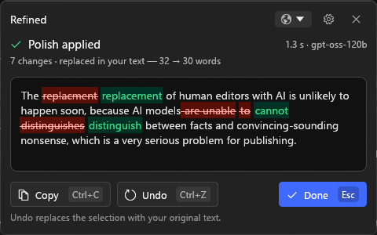
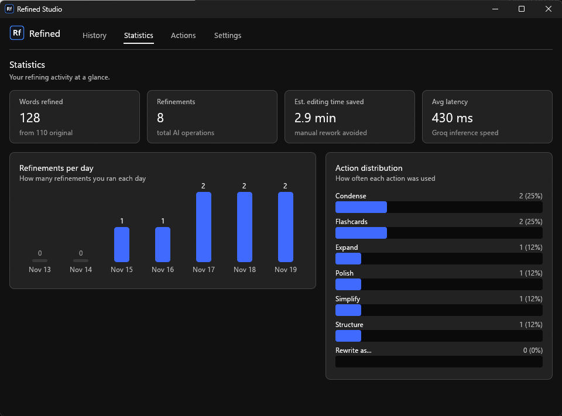

# Refined

I type my study notes in whatever app I already have open. When a paragraph is messy or too long, I used to copy it into a chatbot, explain what I wanted, and paste the answer back. I wanted to stay in my notes.

Refined is a Windows app I built for that. I select a passage, press **Alt+V**, and choose an action. Refined replaces the selection in place and shows what changed. I can turn a definition into flashcards, shorten lecture notes, or untangle an explanation without switching apps.

  
  

The screenshots use sample study notes. I used [Adobe Spectrum 2](https://spectrum.adobe.com/) as the design reference. Refined is an independent project.

## Install

Windows 10 or 11, 64-bit. Download the latest `Refined-Setup` from [GitHub Releases](https://github.com/Nikityyy/refined/releases/latest). It installs for your Windows account, adds Refined to the Start menu, and offers a desktop shortcut. It needs no administrator access. Pick `Refined.exe` if you want the portable build.

The installer is unsigned, so Windows may show a SmartScreen warning. Each download has a SHA-256 checksum alongside it. On startup, Refined checks GitHub for updates and verifies the new executable before offering **Restart now**. You can also quit Refined from the tray and run a newer installer.

Open **Settings** and paste a [Groq API key](https://console.groq.com/keys). Refined loads the chat models available to your account. It needs an internet connection to refine text.

## Use

- **Alt+V** opens the palette when text is selected. Use the number keys or **↑ / ↓** and **Enter** to pick an action. Change the shortcut in Settings.
- **Polish**, **Condense**, **Expand**, **Structure**, and **Simplify** edit your notes. **Flashcards** makes question-and-answer pairs for active recall. **Rewrite as…** takes your own instructions.
- The diff shows what changed after the edit. Use **Undo** to ask the editor to undo the paste. **Esc** or a click outside closes the palette.
- Refined uses the selection’s language by default. Pick a different output language from the palette when needed.
- In Studio, I can see past edits, check how many words I processed, customize the prompts, and add my own actions. Closing Studio keeps Refined in the tray.

## Which model I use

I measured the Groq models available to my key on six short study tasks. **Study preset** uses GPT-OSS 120B at Low. It passed all six cases at a median of **517 ms**. **Quick edits** uses GPT-OSS 20B at Low. Its median was **359 ms**, and one answer switched languages. The [benchmark](docs/model-benchmark.md) includes the other models and what I checked in each answer.

## How it works

Refined is a Rust app with an egui desktop interface. It uses Windows clipboard and keyboard APIs to read selected text and paste the result. Rich formatting depends on how the editor handles a plain-text paste. Selected text and prompts go to Groq for processing. Settings, the API key, and edit history are stored under `%LOCALAPPDATA%\Refined`. Treat that folder as private. Uninstalling keeps it.

The portable executable is 4.56 MB and the installer is 4.00 MB. On my Windows test machine with 160 saved edits, the median working set was about 66 MiB after starting in the tray and 114 MiB with Studio open. Refined loads its fonts and history when needed and builds a history diff when I open it.

To build from source, install [Rust](https://rustup.rs) with the Windows MSVC tools and run `cargo build --release --locked`. For the installer, install [Inno Setup](https://jrsoftware.org/isdl.php) 6.7.3 or newer and run `powershell -File .\build-installer.ps1`.

## Building Refined

Gemini was horrible for this project. GLM 5.3 and Mistral 4 did great work and still left issues I needed to fix. I finished Refined with GPT-6.2 Sol.

## License

MIT
