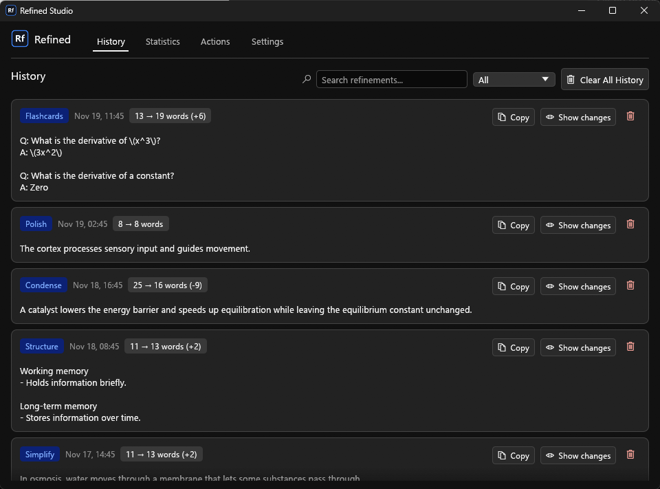

# Refined

I type my study notes in whatever app I already have open. When a paragraph is messy or too long, I used to copy it into a chatbot, explain what I wanted, and paste the answer back. I wanted to stay in my notes.

Refined is a Windows and Linux app I built for that. I select a passage, press **Ctrl+Shift+X**, and choose an action. Refined replaces the selection in place and shows what changed. I can turn a definition into flashcards, shorten lecture notes, or untangle an explanation without switching apps.

  
  

The screenshots use sample study notes. I used [Adobe Spectrum 2](https://spectrum.adobe.com/) as the design reference, and the icons are Adobe's Spectrum 2 workflow icons under the Apache 2.0 license (see `assets/refined-icons-LICENSE.txt`). Refined is an independent project and is not affiliated with Adobe.

## Install

Windows 10 or 11, 64-bit. Download the latest `Refined-Setup` from [GitHub Releases](https://github.com/Nikityyy/refined/releases/latest). It installs for your Windows account, adds Refined to the Start menu, and offers a desktop shortcut. It needs no administrator access. Pick `Refined.exe` if you want the portable build.

The installer is unsigned, so Windows may show a SmartScreen warning. Each download has a SHA-256 checksum alongside it. On startup, Refined checks GitHub for updates and verifies the new executable before offering **Restart now**. Close the edit palette before restarting. You can also quit Refined from the tray and run a newer installer.

On Linux, download `refined-linux-x86_64` from the same page, make it executable with `chmod +x refined-linux-x86_64`, and run it. It needs GTK 3 and OpenSSL 3, which current desktop distributions include. The tray icon needs `libayatana-appindicator3-1`; without it, starting Refined again opens Studio. The shortcut works on X11. Wayland does not let apps register global shortcuts, so add a shortcut in your desktop settings that runs `refined-linux-x86_64 --trigger`. Settings shows the exact command. On Wayland, Refined pastes automatically into X11 apps and puts the result on the clipboard for the others.

Open **Settings** and paste a [Groq API key](https://console.groq.com/keys). Refined loads the chat models available to your account. It needs an internet connection to refine text.

## Use

- **Ctrl+Shift+X** opens the palette when text is selected. Use the number keys or **↑ / ↓** and **Enter** to pick an action. Change the shortcut in Settings.
- With nothing selected, **Ctrl+Shift+X** uses the text on your clipboard. Copy a passage, place the cursor in your document, press the shortcut, and Refined pastes the refined version there. The palette shows which text it will use. Turn off **Paste results made from copied text** in Settings to put the result on the clipboard instead. Images and files on the clipboard are left alone.
- **Polish**, **Condense**, **Expand**, **Structure**, and **Simplify** edit your notes. **Flashcards** makes question-and-answer pairs for active recall. **Rewrite as…** takes your own instructions.
- Drag the Refined header to move the palette or diff. The diff shows what changed after the edit. Use **Undo** to ask the editor to undo the paste. **Esc** or a click outside closes the palette.
- Subscripts and superscripts survive the edit. Refined reads them from Word, browsers, and Acrobat. When text from a PDF viewer arrives flattened, as in `Bn+1`, the model restores the notation where it is clear. Typed notation such as `B_n` or `x^2` becomes real formatting. Plain-text editors receive characters such as Bₙ₊₁ and x².
- Refined uses the selection’s language by default. Pick a different output language from the palette when needed.
- In Studio, I can see past edits, check how many words I processed, customize the prompts, and add my own actions. Closing Studio keeps Refined in the tray.

## Which model I use

I measured the Groq models available to my key on six short study tasks. **Study preset** uses GPT-OSS 120B at Low. It passed all six cases at a median of **517 ms**. **Quick edits** uses GPT-OSS 20B at Low. Its median was **359 ms**, and one answer switched languages. The [benchmark](docs/model-benchmark.md) includes the other models and what I checked in each answer.

Refined opens the connection to Groq while the palette is open, so the request skips the connection setup. In my test this saved about 280 ms per edit. Connection attempts give up after 4 seconds instead of waiting for the operating system's timeout, which can take about 21 seconds on Windows. When Groq's free-tier token limit is briefly reached, Refined waits up to 5 seconds and retries once. Releases before 0.4.0 defaulted to High reasoning; Refined moves that default to Low once.

## How it works

Refined is a Rust app with an egui desktop interface. On Windows it uses the clipboard and keyboard APIs to read selected text and paste the result. On Linux it reads the highlighted text from the primary selection, so your clipboard stays as it was until the result is pasted, and it pastes through the X11 XTEST extension. When an action returns headings, lists, bold, or italics, Refined supplies formatted HTML and a readable plain-text version. Refined uses the same formats when you copy from the diff or history. Unformatted results use a plain-text paste. Selected text and prompts go to Groq for processing. Settings, the API key, and edit history are stored under `%LOCALAPPDATA%\Refined` on Windows and `~/.local/share/refined` on Linux. Treat that folder as private. Uninstalling keeps it. Each edit appends one line to the history file instead of rewriting the whole history.

For my v0.3.0 measurements, the portable executable was 4.56 MB and the installer was 4.00 MB. On my Windows test machine with 160 saved edits, the median working set was about 66 MiB after starting in the tray and 114 MiB with Studio open. Refined loads its fonts and history when needed and builds a history diff when I open it.

To build from source, install [Rust](https://rustup.rs) with the Windows MSVC tools and run `cargo build --release --locked`. On Linux, install the GTK 3 and libxdo development packages first (`libgtk-3-dev libxdo-dev` on Debian and Ubuntu). Pushing a version tag builds both platforms with GitHub Actions and publishes the release. For the installer, install [Inno Setup](https://jrsoftware.org/isdl.php) 6.7.3 or newer and run `powershell -File .\build-installer.ps1`.

## Building Refined

Gemini was horrible for this project. GLM 5.3 and Mistral 4 did great work and still left issues I needed to fix. I finished Refined with GPT-6.2 Sol.

## License

MIT
